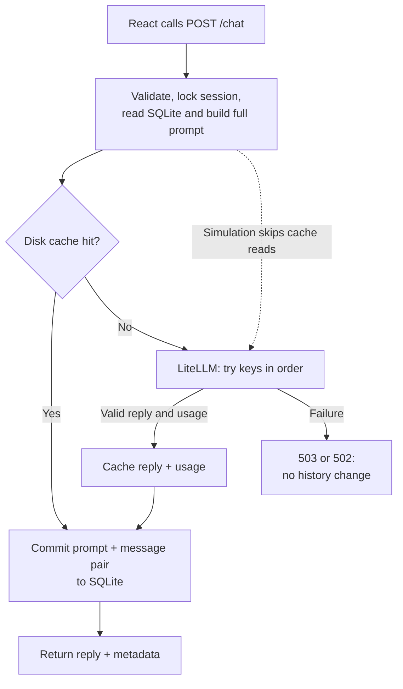

# Lyftr

Lyftr is a small chat app that remembers the conversation, switches API keys when a provider fails, and reuses cached answers. Each reply shows its source, model, response time, and input/output token usage so you can see what happened on that request.

Built with React, TypeScript, and Vite on the frontend; FastAPI, SQLite, and LiteLLM on the backend.

## Live URLs

| Service | Link |
| --- | --- |
| Frontend | [lyftr.nishantraj.me](https://lyftr.nishantraj.me) |
| Backend API | [16.179.206.95.sslip.io](https://16.179.206.95.sslip.io) |
| GitHub | [nishantnsut27/lyftr-assignment](https://github.com/nishantnsut27/lyftr-assignment) |

The frontend runs on Vercel. The backend runs on AWS EC2 behind Caddy for HTTPS, with SQLite history and the LiteLLM disk cache stored on a persistent volume.

## Run locally: with Docker and without

### Configuration

Clone the repository and create your local environment file:

```sh
git clone https://github.com/nishantnsut27/lyftr-assignment.git
cd lyftr-assignment
cp .env.example .env
```

Shell examples use Bash; on Windows, use Git Bash. The `uv` and `npm` commands also work in PowerShell.

In `.env`, replace `LLM_API_KEYS` with at least two distinct Groq keys, separated by commas. Their order becomes `key_1`, `key_2`, and so on. The live deployment uses three keys; configuring three locally lets you try the two-key failure example below.

[`.env.example`](.env.example) lists every setting. Its defaults are ready for local use once you add your keys:

| Setting | Local default / purpose |
| --- | --- |
| `LLM_MODEL` | `groq/openai/gpt-oss-20b`, used for every key |
| `DATABASE_URL` | `sqlite:///./data/app.db` outside Docker |
| `LLM_CACHE_DIR` | `./data/llm-cache` outside Docker |
| `ALLOWED_ORIGINS` | Explicit localhost frontend origins |
| `ENABLE_FAILURE_SIMULATION` | `true`, enabling the verification header |
| `VITE_API_BASE_URL` | `http://localhost:8000` |

Provider keys stay on the backend. Keep `.env` private; it is ignored by Git. The example also sets the default system prompt, a 30-second inference timeout per key, and a 1,024-token output limit.

### With Docker

Install Docker with Compose and GNU Make, then run:

```sh
make up
```

Open [http://localhost:3000](http://localhost:3000). The API is at [http://localhost:8000](http://localhost:8000). Both images use multi-stage builds and non-root runtimes; startup waits for the backend to become healthy.

To stop the stack:

```sh
make down
```

The named `lyftr_data` volume is preserved. Compose stores the database at `/data/app.db` and the cache at `/data/llm-cache`, so both survive container restarts and recreation.

Without Make, the equivalent commands are:

```sh
docker compose --project-name lyftr up --build --detach --wait --wait-timeout 180
docker compose --project-name lyftr down --timeout 30
```

### Without Docker

Install Python 3.12, [uv](https://docs.astral.sh/uv/), and Node.js 22.12 or later. From the repository root, start the backend:

```sh
uv sync --project backend --locked --python 3.12
uv run --project backend --locked uvicorn app.main:create_app --factory --app-dir backend --host 127.0.0.1 --port 8000 --workers 1 --no-access-log
```

In a second terminal, also from the repository root:

```sh
npm --prefix frontend ci
npm --prefix frontend run dev
```

The same local URLs apply. SQLite tables are created on startup, and history/cache files live under `./data`.

### Hosting

[`docker-compose.aws.yml`](docker-compose.aws.yml) runs the backend and Caddy on EC2. To use it on a VM with Docker installed, copy `.env.example` to a private `.env.aws`, add your keys, set `BACKEND_HOSTNAME` to a hostname pointing to the VM, and set `ALLOWED_ORIGINS` to your exact frontend HTTPS origin. Allow inbound ports 80/443, then run:

```sh
docker compose --env-file .env.aws -f docker-compose.aws.yml up --build --detach --wait --wait-timeout 300
```

This uses the persistent `lyftr_aws_data` volume on the VM disk. For Vercel, choose `frontend` as the root directory and set `VITE_API_BASE_URL` to the HTTPS backend URL. Vite embeds that URL at build time, so changing it requires rebuilding the frontend. Adding a frontend domain also requires updating backend CORS and recreating the backend to reload its environment.

## Design decisions: key fallback, caching, SQLite session storage

### Key fallback

I use one model across the key pool so a fallback keeps the same model behavior. The gateway calls LiteLLM with each key in configured order. Rate limits, quota exhaustion, and provider 5xx responses move to the next key; hidden retries are disabled so `key_id` and `fallback_attempts` reflect the attempts made.

If every eligible key fails, the API returns `503` with `{"detail":"all providers unavailable"}`. Other provider failures or invalid completions return a safe `502`. Provider exceptions and credentials never appear in public errors.

### Caching

LiteLLM's built-in disk cache uses the model and the complete ordered message list: system prompt, saved history, and new user message. Session IDs and credentials are excluded, allowing the same first prompt in another session to reuse an answer. Changing the prompt, history, or model changes the cache identity.

A hit returns the original reply and token usage with `resolution_source: "LLM_CACHE"`, `key_id: null`, and `fallback_attempts: 0`. Latency is measured for the current request. Enabled failure simulation skips cache reads so even a warm prompt exercises the key loop.

### SQLite and conversation state

The backend owns the history; the browser sends only `session_id`, the new `message`, and an optional `system_prompt`. Each page load starts a fresh session. SQLite stores the effective prompt separately from user/assistant messages, and the history endpoint returns those messages oldest first with the assistant's original metadata.

A valid reply and token usage are required before saving a turn. The prompt, user message, and assistant message commit together, so failed requests leave the conversation unchanged. A per-session lock covers reading, inference, and saving; SQLite WAL and short transactions let unrelated sessions progress independently. The backend runs with **one worker**, because these locks are in-process.

The request flow is:



## Verification: how to see failover, cache hits and per-message token usage

### Chat and history

The API exposes exactly three application endpoints; automatic documentation routes are disabled.

| Endpoint | What it does |
| --- | --- |
| `GET /health` | Checks SQLite, the loaded key pool, and the disk cache |
| `POST /chat` | Generates or retrieves a reply and saves the successful turn |
| `GET /sessions/{session_id}/messages` | Returns that session's stored user/assistant history |

Chat requires string fields: `session_id` is 1-128 characters, and `message` is 1-4,000 characters after trimming. An optional string `system_prompt` changes the session instructions.

Try the endpoints locally with these Bash commands. Set `API=https://16.179.206.95.sslip.io` to use the public backend instead.

```sh
API=http://localhost:8000
SESSION="readme-$(date +%s)-$$"

curl -sS "$API/health"

curl -sS "$API/chat" \
  -H 'Content-Type: application/json' \
  -d "{\"session_id\":\"$SESSION\",\"message\":\"My name is Mira. Acknowledge briefly.\"}"

curl -sS "$API/chat" \
  -H 'Content-Type: application/json' \
  -d "{\"session_id\":\"$SESSION\",\"message\":\"What is my name?\"}"

curl -sS "$API/sessions/$SESSION/messages"
```

The follow-up should remember Mira. History contains four messages in user/assistant order and no system prompt. Unknown history returns `404` with `{"detail":"session not found"}`; invalid chat input returns JSON `422` with a `detail` field.

### Cache and token usage

1. Open the frontend and send a first message containing a unique tag, such as a phrase you make up for this check. Confirm `LIVE_INFERENCE` and note the reply, latency, and token values.
2. Reload, then send the exact same first message with the same system prompt. Expect `LLM_CACHE`, identical reply text and token values, and lower latency.
3. Reload again and send a different, unused prompt. Expect a live response.

Each assistant reply displays `resolution_source`, `model`, `latency_ms`, `input_tokens`, and `output_tokens`. Input tokens describe that request's full prompt, including history; output tokens describe that reply. Neither is an accumulated usage total. The API also reports the successful `key_id` and `fallback_attempts`, with null/zero values on cache hits.

### Failover

Keep `ENABLE_FAILURE_SIMULATION=true` on the backend. Using the `API` and `SESSION` variables above, run:

```sh
curl -sS -i "$API/chat" \
  -H 'Content-Type: application/json' \
  -H 'X-Simulate-Failure: key_1=429' \
  -d "{\"session_id\":\"$SESSION\",\"message\":\"What is my name?\"}"
```

Repeat with each header value below and inspect the response metadata:

| `X-Simulate-Failure` value | Expected result |
| --- | --- |
| `key_1=429` | Real `200` reply from `key_2`; one fallback |
| `key_1=500` | Real `200` reply from `key_2`; one fallback |
| `key_1=429,key_2=500` | Real `200` reply from `key_3`; two fallbacks, with three keys configured |
| `*=429` | `503` with `{"detail":"all providers unavailable"}` |

Compare the history endpoint immediately before and after the wildcard request: nothing is added. Remove the header to retry normally. Simulation applies only to that request; malformed enabled headers return `422`, and headers are ignored when simulation is disabled.

### Automated checks and persistence

After installing the backend and frontend dependencies, run these from the repository root:

```sh
uv run --project backend --locked pytest
uv run --project backend --locked ruff check backend
uv run --project backend --locked ruff format --check backend
npm --prefix frontend run typecheck
npm --prefix frontend run build
uv run --project backend --locked python scripts/check_secrets.py
```

Backend tests use injected fake inference and the real disk cache. They cover validation, fallback, cache identity/usage, history isolation, failed writes, concurrency, persistence, CORS, and secret redaction.

The [smoke script](scripts/smoke_backend.py) checks the running service with real Groq requests, including multi-turn recall, cache usage, failover, failure atomicity, and CORS. It saves a local checkpoint for restart verification:

```sh
uv run --project backend --locked python scripts/smoke_backend.py --url http://localhost:8000 --origin http://localhost:3000
```

Restart the Docker backend, then verify the saved history and cached reply/token usage:

```sh
docker compose --project-name lyftr restart backend
uv run --project backend --locked python scripts/smoke_backend.py --url http://localhost:8000 --verify-restart
```

For a non-Docker run, stop and restart the backend process before the same verification command. To check the public deployment:

```sh
uv run --project backend --locked python scripts/smoke_backend.py --url https://16.179.206.95.sslip.io --origin https://lyftr.nishantraj.me
```

If chat cannot connect, check `/health`, the frontend's built API URL, and whether backend CORS includes the exact frontend origin.

## Setup Used: your editor and AI tools

I used **Visual Studio Code** as my editor and **OpenAI Codex** to help with implementation, debugging, and verification. Development was on Windows with PowerShell, Python 3.12/uv, Node.js/npm, and Docker Desktop. Playwright/Chromium and axe were used to check browser behavior, responsive layouts, and accessibility.

## Bonus features (if any): what you added beyond the requirements and why

- **Session instructions:** a collapsible system-prompt editor lets you adjust how the assistant answers. Edits are saved with the next successful turn, including an explicitly empty prompt.
- **Markdown replies:** headings, lists, tables, and code blocks make longer answers easier to read. Raw HTML stays inert, and remote Markdown images are not fetched.
- **Copy controls:** copy the complete reply or system prompt with feedback, keeping telemetry out of copied replies.
- **Message navigation:** desktop markers with previews help you return to earlier messages in a long conversation.
- **Retry and edit:** recover a failed message with its original prompt, or restore both fields for editing, without duplicating the visible turn.
- **Motion preferences:** reply reveals and decorative animations respect reduced motion and page visibility; cached replies appear immediately.
